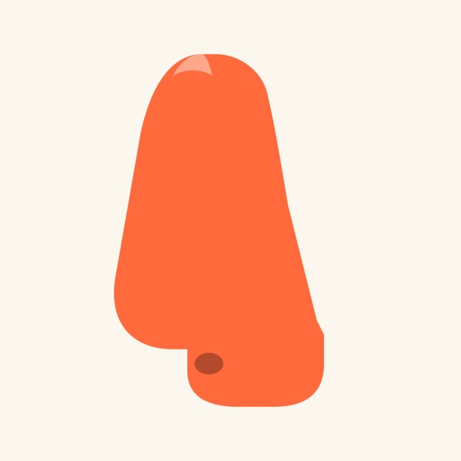

# Lorenzo Coslado

**Product builder · Web, mobile & macOS**

I design and build applications, from the first product idea to the interface and implementation, with particular care for the user experience.

Based in Paris, France. Working on engineering and automation at **Airbus**, and studying engineering at **ESIEA**.

[Portfolio](https://coslado.fr) · [LinkedIn](https://www.linkedin.com/in/lorenzo-coslado-5ab552249/) · [Email](mailto:lorenzo.coslado@gmail.com)

## Selected work

I design and develop the following products.

| Project | What it does | Explore |
| :---: | --- | --- |
|  **Lunetric** | Web analytics connecting traffic, visitor actions and confirmed payments, with reports accessible through MCP. | [Website](https://lunetric.io) · [Case study](https://coslado.fr/projects/lunetric) |
|  **FRED** | A marketplace connecting customers with 3D printing farms for on-demand manufacturing. Currently in private beta. | [Website](https://fredpod.com) · [Case study](https://coslado.fr/projects/fred) |
|  **Bruma** | An iPhone dream journal with AI interpretations, illustrations and recurring pattern exploration. | [App Store](https://apps.apple.com/fr/app/bruma-r%C3%AAves-signification/id6788626311) · [Case study](https://coslado.fr/projects/bruma) |
|  **Mugshot** | Open-source macOS app for local facial authentication with sudo, an optional session unlock and a SwiftUI interface. | [Source code](https://github.com/Lorenzo-Coslado/macos-faceid) · [Case study](https://coslado.fr/projects/mugshot) |
|  **O’Pif** | An iPhone party game where 2–8 players guess numbers and share a single phone. | [App Store](https://apps.apple.com/fr/app/opif-quiz-jeu-de-soir%C3%A9e/id6778270746) · [Case study](https://coslado.fr/projects/opif) |

## How I work

- Understand the problem and define a clear product direction.
- Design the user journey and interface alongside the implementation.
- Build, experiment and refine the details that make an application useful.

---

### 🤖 NewYearBot

<!-- NEW-YEAR-COUNTDOWN:START -->
**49 days until 2027.**
<!-- NEW-YEAR-COUNTDOWN:END -->

Updated daily by [NewYearBot](.github/workflows/NewYearBot.yml) at 11:27 UTC.
